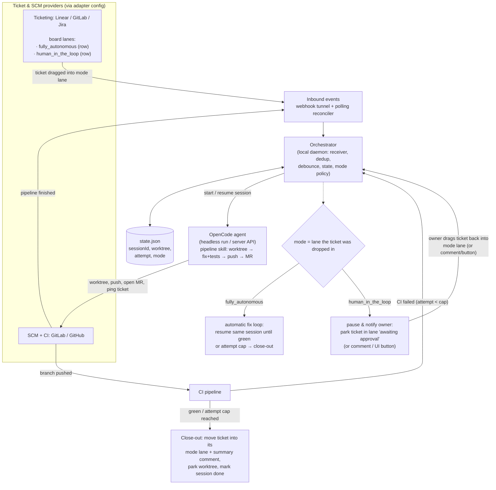

# 04 — Prototype plan

## MVP architecture



One Node/Bun daemon, single binary-ish, no queue broker needed if you accept "one ticket = one JSON row on disk". npm deps: `express` (or Bun.serve), platform SDKs (`@linear/sdk`, gitlab-api client or raw fetch), `@opencode-ai/sdk`/`@opencode-ai/client` (opencode client).

## Execution modes

**Mode selection via ticketing lanes.** The ticketing provider's board has two dedicated rows/lanes — one per mode (`human_in_the_loop`, `fully_autonomous`). The lane is the user interface for both starting and finishing:

- **Pickup**: dragging a ticket into a mode lane = "run this in that mode". The orchestrator immediately starts the agent and moves the ticket out of the lane into an internal working area (agent state/label, e.g. `agent: working <runId>`) — so the lane holds only _fresh requests_.
- **Completion**: on close-out (CI green, attempt cap reached, or kill switch) the orchestrator moves the ticket **into the mode lane** it was picked up from, with a summary comment. The lane thereby doubles as the per-mode outbox of completed runs.
- **Guard rails**: self-moves (actor = bot user) are ignored via the adapter's actor filter, so completion-moves never retrigger pickup; only events whose ticket was previously `agent: working` (or that enter a lane from outside the board) count as pickup.
- **HITL approval gesture**: on a CI failure the agent moves the ticket into a per-mode _awaiting-approval_ holder (or comments and pins it); approval = the owner drags it back into the mode lane (or optional comment/button signals). Same gesture vocabulary, no new UI.

|                     | **human_in_the_loop** (default, recommended)                                                                                                                             | **fully_autonomous**                                                   |
| ------------------- | ------------------------------------------------------------------------------------------------------------------------------------------------------------------------ | ---------------------------------------------------------------------- |
| Ticket → mode lane  | agent starts round 1 automatically                                                                                                                                       | agent starts round 1 automatically                                     |
| MR opened           | posted; fix rounds are **announced**                                                                                                                                     | posted silently                                                        |
| CI failed           | **pause**: ticket parked in awaiting-approval; next fix round only starts when the owner re-drops it into the mode lane (or optional comment `@agent retry` / UI button) | automatic resume of the same session with the CI log, loop until green |
| Attempt cap reached | human notification; ticket moved into mode lane with "capped" summary                                                                                                    | ticket moved into mode lane; summary comment; optionally tag `@owner`  |
| Kill switch         | ticket moved back to backlog aborts the session (`POST /session/:id/abort`)                                                                                              | same                                                                   |

Both modes share everything (adapters, state, worktrees, prompts); only the _gate between CI-failure event and next agent round_ differs. In HITL the pause state must be persistent (state.json `awaiting-approval`), so the approval can arrive hours later via any of the configured signals.

## Provider-agnostic config

The orchestrator is provider-agnostic: each provider is an _adapter_ implementing one narrow interface (receive events, filter/match tickets, fetch CI log, post comments, resolve state map), selected and parameterized by config. Nothing provider-specific leaks into the core loop.

```ts
// agent-orchestrator.config.ts
export default {
  mode: 'human_in_the_loop', // default | "fully_autonomous"
  caps: { attempts: 3, noProgress: true, roundTimeoutMin: 15 },

  agent: {
    runtime: 'server', // "server" | "cli" | "embedded-sdk"
    serverUrl: 'http://localhost:4096',
    agent: 'build',
    model: 'anthropic/claude-sonnet-4',
    permissions: 'pipeline-strict', // opencode permission profile
  },

  adapters: {
    ticketing: {
      provider: 'linear', // "linear" | "gitlab" | "github" | ...
      secretEnv: 'LINEAR_WEBHOOK_SECRET',
      lanes: {
        // board rows/lanes per mode; resolved to provider state/label IDs at startup
        fully_autonomous: 'lane-id-autonomous',
        human_in_the_loop: 'lane-id-hitl',
        awaiting_approval: 'lane-id-awaiting', // HITL parking spot
      },
      teams: ['team-uuid'],
    },
    scm: {
      provider: 'gitlab', // "gitlab" | "github"
      secretEnv: 'GITLAB_WEBHOOK_TOKEN',
      host: 'https://gitlab.com',
      repos: ['org/repo-a'], // allowlist
      ci: { successStatus: 'success', fetchJobLogs: true },
    },
  },

  delivery: {
    webhooks: { port: 8899, tunnel: 'cloudflared' }, // optional; polling always on
    polling: { intervalSec: 60 }, // reconciler, source of truth
  },

  approval: {
    // human-in-the-loop signals (any of); primary is the lane drag-back gesture
    comments: ['@agent retry'],
    uiButton: true,
  },
};
```

Core loop signature: `startTicket(ticketRef)` / `onCiResult(ticketRef, ciResult)` — both operate on adapter-neutral types (`Ticket`, `CiResult`), so swapping Linear→GitHub or GitLab→GitHub is a config change, not a code change (plus auth env vars).

## Build phases

**Phase 1 — polling-only closet (0.5–1 day).**
No tunnel, no webhook. Cron-ish loop every 60 s:

1. Linear/GitLab: find tickets in a mode lane with the allowlist label, no `sessionId`.
2. `spawn_opencode_run(ticket)` using the pipeline-skill prompt; write `sessionId`/worktree/branch/MR URL; comment on ticket "picked up by agent, session <id>".
3. On MR open: poll CI; if red → run one CI-fix round (`opencode run -s <id> "CI failed..."`) and comment on the ticket.
   Ship this, run it on 2–3 real tickets. This alone proves the whole loop.

**Phase 2 — webhooks for latency (~0.5 day).**
`cloudflared` named tunnel + express endpoint; HMAC verify; dedup table; debouncer; replace the "ticket was picked up" poll trigger with the push trigger (keep polling as reconciler only).

**Phase 3 — polish (1 day).**

- concurrency cap, attempt caps, no-progress detection,
- `GET /event` SSE tail → log file per session for debugging,
- small status UI / `opencode` dashboard over state.json,
- GitLab self-hosted if applicable + GitHub parity.

## Rough code shape (server-API flavor)

```ts
// receiver.ts (skeleton)
app.post("/hooks/linear", rawBodyParser, hmacMiddleware, dedupMiddleware, async (req, res) => {
  res.sendStatus(202) // ack fast; do work async
  const ev = req.body
  if (ev.type !== "Issue") return
  if (ev.action !== "update" || !ev.updatedFrom?.stateId) return
  if (!stateMap.isTodo(ev.data.stateId)) return   // e.g. new state type = "started"
  if (!allowlist.has(ev.data.teamId)) return
  debounced.enqueue(ev.data.identifier, 10_000, () => startTicket(ev.data.identifier))
})

async function startTicket(key: string) {
  const wt = makeWorktree(key)                       // pipeline step 1, shared helper
  const s = await oc.sessions.create({ location: { directory: wt } })
  state.save(key, { sessionId: s.id, ... })
  await oc.sessions.prompt({ sessionID: s.id, text: pipelinePrompt(key) })  // steps 0–7
  state.update(key, { status: "waiting-for-ci" })
}

async function onCiFailed(key: string, log: string) {
  const st = state.get(key); if (st.attempt >= 3) return
  await oc.sessions.prompt({ sessionID: st.sessionId,
    text: `CI failed (attempt ${st.attempt + 1}). Failing job log:\n${log}\nFix, push, re-open MR, report.` })
  state.update(key, { attempt: st.attempt + 1, status: "waiting-for-ci" })
}
```

## Risks / open questions

1. **Agent reliability in the fix loop** is the real risk, not the plumbing. The pipeline skill's step-7 discipline (read log, minimal fix, re-run gates) helps; still expect some tickets to hit the cap.
2. **CI webhook tokens** live on the ticket platform; if anything leaks, rotate. The agent should never see them.
3. **Laptop sleep pauses everything** — acceptable for personal use; if uptime matters, move the orchestrator (not the agent!) to a $5 VPS / NAS and keep OpenCode local or also remote.
4. **Cost**: N retry rounds × long-context sessions; the reuse-a-session design mitigates somewhat; monitor per-ticket.
5. **Race: user edits ticket while agent works** — pick a rule (agent wins until CI end, or agent aborts when ticket returns to backlog) and surface it in the ticket comment trail.
6. Existing prior art validating the pattern: GitLab Duo's `fix_pipeline/v1` flow (starts a session from a failed pipeline URL — exactly your round-2 concept), GitHub Copilot coding agent (issue→PR→CI→fix loop), and `imnatann/opencode-auto-batch` (OpenCode server + session resume orchestration).

---

Prev: [03-delivery-reliability-security.md](03-delivery-reliability-security.md) · Next: [05-implementation-checklist.md](05-implementation-checklist.md) · Back to [README](README.md)
